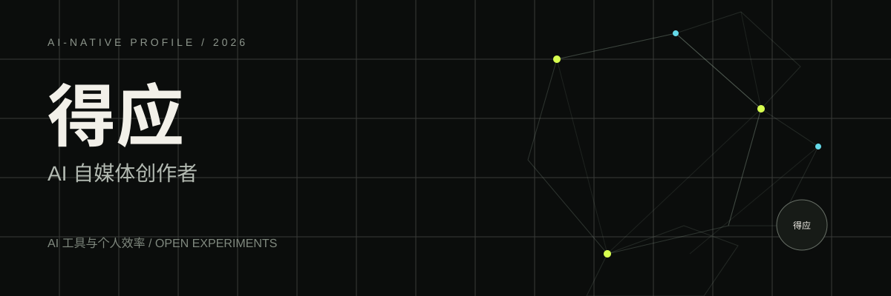

  

# Deying-Ai

> 把复杂问题，变成简单好用的产品。

这里是 Deying-Ai 的 AI 原生个人档案：关注人与 AI 的协作方式，从真实问题出发，把想法、原型与产品体验串成一条完整路径。

**当前聚焦：** AI-native profile  
**所在地：** Remote  
**状态：** <strong>开放交流</strong>

[GitHub](https://github.com/Deying-Ai)

---

## 方向 / Focus

| 领域 | 我在做什么 | 关键词 |
| --- | --- | --- |
| **AI 产品** | 从用户任务出发，定义模型真正适合介入的位置，做出可验证、可迭代的产品。 | 产品策略 · 原型验证 · 人机协作 |
| **智能工作流** | 把重复工作拆成清晰的输入、判断和输出，让自动化成为可靠的生产工具。 | 流程设计 · Agent · 效率系统 |
| **开放实验** | 保持对新技术的好奇，用小而完整的实验验证想法，并沉淀为可复用的方法。 | 快速原型 · 开源 · 持续学习 |

## 代表项目 / Selected Work

| # | 项目 | 简介 | 标签 | 链接 |
| --- | --- | --- | --- | --- |
| 001 | **AI 个人档案** | 一个结合个人介绍、项目展示与本地档案问答的 GitHub Pages 实验。 | AI Profile · GitHub Pages · Web | [访问](https://deying-ai.github.io/deying-ai/) |

## 工具 / Toolkit

`HTML` `CSS` `JavaScript` `Node.js` `Git` `GitHub Pages`

## 轨迹 / Journey

| 时间 | 主题 | 说明 |
| --- | --- | --- |
| **现在** | 搭建 AI 个人档案 | 把个人介绍、方向与项目整理成一个可持续更新的数字档案。 |
| **持续** | 探索 AI 与个人工作流 | 关注 AI 如何进入真实任务，并成为可靠、自然的协作工具。 |
| **下一步** | 补充真实作品与经历 | 逐步加入完整项目、学习记录与可验证的实践成果。 |

## 个人主页 / Profile Site

这个仓库同时包含一个可直接部署到 GitHub Pages 的 AI 原生个人档案：

- 动态关系图主视觉
- 本地运行的档案问答，不上传个人信息
- 桌面与移动端响应式布局
- 修改 `profile.config.json` 后运行 `npm run build` 即可同步 README 与网页内容

---

  BUILT WITH CURIOSITY / 2026

